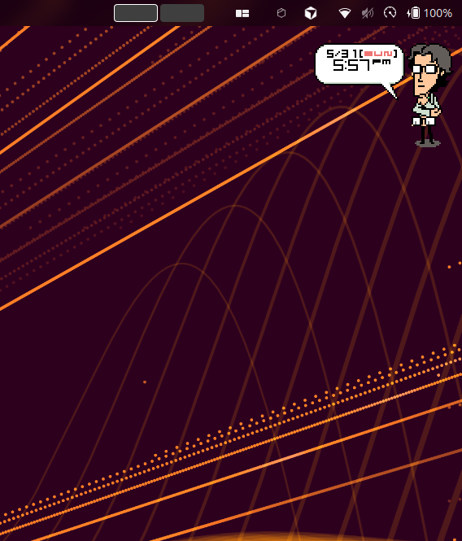
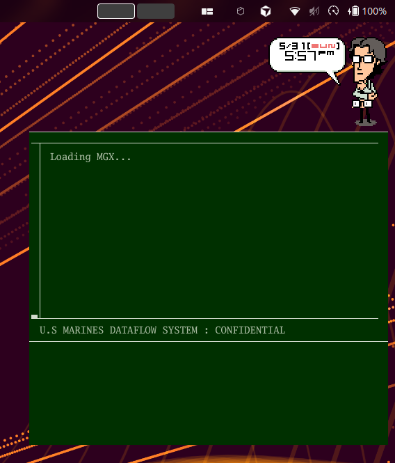

# otaclock

|  |  |
|:----------------------------------:|:------------------------------------------------------------:|
|             otaclock              |        otaclock-mgx-emulator        |

## About

This is not the original [Konami Otaclock (2006)](https://metalgear.fandom.com/wiki/Otaclock), it's a re-imagined widget.

This otaclock implementation features:

- Pomodoro clock (replacing the original alarm clock),
- MGX boot sequence,
- light (optional) chatbot integration (Anthropic, OpenAI).

It is written in Go and renders with [Ebitengine](https://ebitengine.org/).

## Requirements

- Go 1.26+
- **Building on Linux** needs the GL/X11 and ALSA development headers (Ebitengine uses CGO on Linux):
  - `libgl1-mesa-dev`
  - `libxrandr-dev`
  - `libxcursor-dev`
  - `libxinerama-dev`
  - `libxi-dev`
  - `libxxf86vm-dev`
  - `libasound2-dev`
  (see `task install-linux-deps`).
- **Building for Windows** needs nothing extra — it cross-compiles with
  `CGO_ENABLED=0` from any platform.
- **Building for macOS** must be done on a Mac (with the Xcode command-line tools)
- Window transparency on Linux/X11 requires a running compositor.

## Usage

(Optional) environment variables:

- `ANTHROPIC_API_KEY`
- `OPENAI_API_KEY`
- `OTA_LLM_PROVIDER` (`claude` | `openai`)
- `OTA_24H_CLOCK` (`1` / `true`)
- `ANTHROPIC_MODEL`
- `OPENAI_MODEL`

Controls:

- **Drag** the widget to move it.
- **Double-click** the widget to toggle the chat panel; type `exit` (or press
  `Esc` when the chat is closed) to dismiss.
- **Right-click** the widget for the Pomodoro tools menu.
- **Ctrl** + `+` / `-` to scale the widget; drag the edges to resize.
- Click the Pomodoro countdown to pause/resume; double-click to restart.

### Build and run

```bash
# running with go
go run mian.go
```

### Cross-compile

```bash
task build-windows   # dist/otaclock2-windows-amd64.exe (cross-compiles anywhere)
task build-linux     # dist/otaclock2-linux-amd64 (CGO; build on Linux)
task build-macos     # dist/otaclock2-darwin-<arch> (CGO; can only build on a Mac)
task build-all       # local binary + Windows cross-compile
```

### Docker container

A GUI app in a container needs the host's X11 socket/display shared with the container. Pass an audio device (e.g. `/dev/snd`) if sound is needed.

```bash
$ docker pull aamillan/otaclock:master
$ xhost +
access control disabled, clients can connect from any host
$ docker run --rm -it \
  --name otaclock2 \
  -e DISPLAY="$DISPLAY" \
  -v /tmp/.X11-unix:/tmp/.X11-unix:rw \
  --device /dev/snd \
  aamillan/otaclock:master
```

## References

- [Konami Otaclock (2006)](https://metalgear.fandom.com/wiki/Otaclock)
- [https://github.com/sethen/otaclock](https://github.com/sethen/otaclock)
- [https://github.com/xythobuz/OtaClock](https://github.com/xythobuz/OtaClock)
- [Otaclock sprite database](http://spritedatabase.net/file/455)
- [MGS Boot Sequence Text](https://gamefaqs.gamespot.com/ps2/913941-metal-gear-solid-2-sons-of-liberty/faqs/15109)
- [MGS Boot Sequence Video](https://www.youtube.com/watch?v=QV3EWM6Vq_0)
- [MGS2 BEEP SOUNDS](https://www.konami.com/mg/archive/mgs2_sub/english/alldogtags/download.html)
- [MGS1 Sounds](https://www.spriters-resource.com/playstation/mgs/)
- [MGS1 Fonts](https://gleeson.itch.io/mgs1-fonts)
